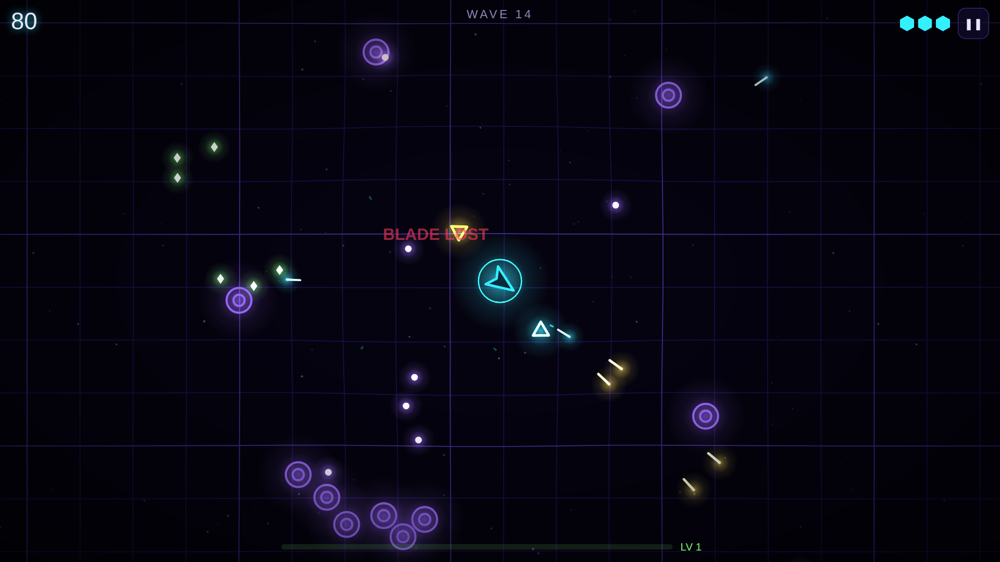

# Neon Swarm

**A neon arena survival shooter written from scratch on HTML5 Canvas, with no game engine, and tuned to stay smooth on phones.**

[](https://neon-swarm-92ee.onrender.com)
[](https://github.com/GaretJax6905/neon-swarm/actions/workflows/python.yml)



> Free hosting: the first visit after a quiet spell can take ~30–60 s to wake up.

| | |
| --- | --- |
| **Front end** | Vanilla JavaScript, HTML5 Canvas 2D, Web Audio API, Pointer Events, PWA |
| **Back end** | Python 3.12, Flask JSON API serving deterministic wave plans |
| **Quality** | 48 automated tests, including 11 real-browser Playwright journeys, plus Black and Pylint. All run in GitHub Actions on every push and PR |
| **Deploy** | Render, auto-deployed from `main` |

A neon arena survival shooter in the browser. Fly a tiny ship around a glowing arena, mow down endless swarms, grab green shards to level up, stack upgrades, and survive **The Hive** every 10 waves.

- **▶ Play:** a fresh random run every time.
- **☀ Daily Run:** everyone gets the exact same waves until midnight UTC. Compare scores.
- Works with keyboard + mouse or touch, and installs to a phone home screen (PWA).

## Controls

| Action | Keyboard / mouse | Phone |
| --- | --- | --- |
| Move | `WASD` / arrow keys | Drag anywhere (floating joystick) |
| Aim + fire | Point the mouse (fires automatically) | Automatic: nearest enemy |
| Dash (invincible) | `Space`, `Shift` or right-click | DASH button |
| Pick an upgrade | `1` `2` `3` or click | Tap a card |
| Pause / mute all / music / FPS | `P` / `M` / `N` / `F` | ❚❚ button, Music checkbox |

If you stop moving the mouse for a couple of seconds, auto-aim takes over.

## The swarm

| Enemy | From wave | Behavior |
| --- | --- | --- |
| 🔷 Drifter | 1 | Wobbles straight at you |
| 🔺 Dart | 3 | Aims (dashed line), pauses, then charges |
| 🟪 Splitter | 5 | Bursts into three fast Shards |
| 🟣 Orbiter | 7 | Circles at range and fires plasma |
| 🛑 Bulwark | 9 | Slow, armored, shoves you back |
| ⬢ **The Hive** | every 10th | Boss: bullet rings, spawns Drifters, enrages at half HP (one more Hive each lap) |

Enemies get +8% HP and +2% speed per wave (speed caps at +60%). Kills chain into a combo multiplier (up to ×5). Getting hit costs a shield; with no shields left, the next hit ends the run.

## Upgrades

| Upgrade | Effect | Limit |
| --- | --- | --- |
| 🛡️ Reinforced Hull | +1 max shield and repair 1 | **Endless** |
| 🔥 Hot Plasma | +1 damage (bullets, blade bullets, blade hits) | **Endless** |
| ⚡ Overclock | Fire 18% faster (+6% per pick after the 6th) | **Endless** |
| 🧲 Tractor Field | Pull XP shards from farther away | **Endless** |
| 🌀 Orbit Blades | +1 blade (see below) | **Endless** |
| 🔱 Split Beam | +1 bullet per shot (blades get +1 per 2 picks) | 4 |
| 🪡 Phase Rounds | Bullets pierce 1 more enemy | 3 |
| 🚀 Thrusters | Move 12% faster | 4 |
| 💨 Blink Drive | Dash recharges 25% faster | 3 |
| 💥 Nova Core | Dashing releases a shockwave | 3 |

**Orbit Blades** spin around the ship, cut enemies they touch, and **shoot** at the nearest enemy at half the ship's fire rate each, using your damage, pierce and fire-rate upgrades. They also **block enemy bullets**, but every blade breaks after **5 hits**. Its color shows how many hits it has left: cyan, then yellow, then red. A broken blade can be bought back on a later level-up.

**Every 5th level** (5, 10, 15, …) repairs **2 shields**, shown on that level's upgrade screen.

## Music

Three original tracks, synthesized live in the browser with the Web Audio API (no audio files, nothing to download or license):

| When | Track |
| --- | --- |
| Menu | Calm: soft pads and a slow arpeggio |
| Normal waves | A-minor synthwave at 112 BPM: arpeggio and bass, then drums, then a lead melody |
| **The Hive** | E-Phrygian at 140 BPM: galloping distorted bass, four-on-the-floor kick, siren lead. It gets brighter and the lead never stops once the Hive is below half health |

Tracks crossfade when a boss arrives or dies, and duck while paused or picking an upgrade. A small step sequencer schedules notes ~0.15 s ahead on the audio clock, so timing stays tight even when frames run long. **N** toggles music, **M** mutes everything, and there's a Music checkbox on the menu. Music starts on your first click or key press, since browsers block sound before that.

## How it stays smooth (60 fps on phones)

- **No `shadowBlur`.** Every glow is a pre-rendered radial-gradient sprite drawn with additive blending (`globalCompositeOperation = "lighter"`).
- **Typed-array pools** for particles, bullets and XP shards: nothing is allocated per frame, so there are no garbage-collection hitches.
- **Batched drawing.** All same-colored shapes go in one path and get stroked once (e.g. ~27 strokes for up to 2,400 particles).
- **Spatial grid collisions** instead of checking every bullet against every enemy.
- **Auto graphics:** if frames run long for ~1.5 s, it steps down High → Medium → Low (lower resolution, fewer particles, no warping grid). You can also pick a level on the menu.
- The background grid is a spring mesh: explosions push it and the ripple spreads.

Measured in headless Chrome: a locked 60 fps on desktop; a phone viewport with the CPU throttled 4× during a wave-30 boss fight stayed at 30–55 fps after auto-dropping to Low.

## How it's built

| File | Job |
| --- | --- |
| `waves.py` | Wave director: seed + wave number → spawn plan (deterministic, so Daily Runs match) |
| `upgrades.py` | The upgrade list, caps and XP curve |
| `app.py` | Flask: the page, `/api/run`, `/api/wave`, `/api/config`, PWA files |
| `static/game.js` | Canvas engine: simulation, rendering, input, HUD, audio (WebAudio synth, no sound files) |
| `tests/` | unit, integration (Flask test client) and e2e (real Chromium via Playwright) |

The browser prefetches the next wave's plan while you fight the current one, so there's no pause between waves.

High scores are an arcade-style top 10 per device (browser local storage): one board for normal runs and one per Daily Run.

## How I worked: AI-assisted, test-verified

Neon Swarm is a sister project to [RPS Chaos](https://github.com/GaretJax6905/rps-chaos). My goal was something far more graphics-heavy that still runs smoothly on a phone. I built it with Claude (an AI coding assistant) as a pair programmer: I set the goals, playtested it, reported what felt wrong, and decided what shipped. The AI wrote most of the code, and CI runs `check.py` on every push.

### One bug, start to finish

[`7ce0ae3`](https://github.com/GaretJax6905/neon-swarm/commit/7ce0ae3): **XP shards overshooting the ship.**

1. **What I noticed while playtesting.** The magnet didn't always pull XP to the ship. Sometimes shards shot straight past it.
2. **The cause.** Shards *accelerated* toward the ship, so fast ones swung past or orbited it. A shard also only locked on after its 0.25 s "pop" out of an explosion, so dashing away during that window left it behind.
3. **The test came first.** We added a real-browser test that drops 40 shards in a ring around the ship while it dashes in two directions. It fails if any locked shard is still loose afterwards.
4. **The first fix wasn't enough.** It steered the shards' velocity instead, and it still failed the new test intermittently. The final fix moves each locked shard's *position* straight at the ship every frame, and collects it once a step would reach the ship. Overshooting is now impossible by construction. The test passed 6 runs in a row, and the full suite stayed green.

The lesson I took from it: a test that reproduces what a player actually saw is what separates "looks fixed" from "is fixed."

## Run it locally

```bash
python3 -m venv .venv
source .venv/bin/activate
pip install -r requirements.txt
python -m playwright install --with-deps chromium
python run.py
```

Open http://127.0.0.1:5050. To play from your phone on the same Wi-Fi: `HOST=0.0.0.0 python run.py`, then open `http://<your-computer's-IP>:5050`.

## Checks

```bash
python check.py          # Black, Pylint, pytest, and real-browser tests
python check.py --fast   # skip the browser tests
```

GitHub Actions runs the same `check.py` on every push and pull request.

## Deploy (Render)

`render.yaml` is a Render Blueprint: free plan, one gunicorn worker, auto-deploys from `main`. The app is stateless, so restarts lose nothing.

## Author

**Thomas Moylan** · IT student at NJIT, building toward front-end engineering · [@GaretJax6905](https://github.com/GaretJax6905)

More projects: [RPS Chaos](https://github.com/GaretJax6905/rps-chaos) (boss-rush RPS with a learning AI and online play) · [Plaque Attack](https://github.com/GaretJax6905/plaque-attack) (educational dental game) · [MoodWave](https://github.com/GaretJax6905/moodwave) (Web Audio synthesizer and visualizer)
